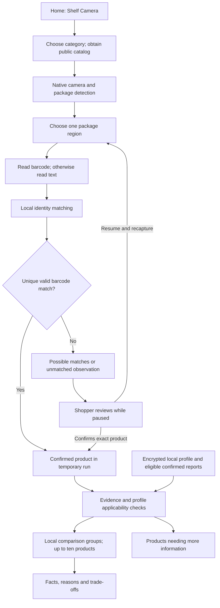

# Shelf Camera - build 13 baseline and new on-device grid flow

**Shelf provider decision — October 23, 2026, 09:53 PM Eastern:** User selected the existing Shelf Camera flow and **GPT-6 Luna**. Verified current code already implements this: iPhone package detection/full-package crops, repeat-sighting checks and on-device **16-cell (4 x 4) grids**; full grids are submitted during capture and Finish flushes any smaller remaining grid. The backend uses GPT-6 Luna for grid identification/review; existing same-category ranking and GPT outside-alternative follow-up are retained. Gemini remains limited to the prepared v6 single-product flow. **17 existing targeted shelf/provider-loader tests passed**, including rolling batches, a 100-product/seven-batch fixture, duplicate/variant handling, cancellation and native final-partial-batch acceptance. These are automated source checks, not a new physical-camera test or live GPT call. No app/backend source change, restart, native build or upload was needed. Shelf-provider discussion is resolved; the phone upload remains deferred. Evidence: artifacts/shelf-gpt-retained-2026-10-23/targeted-tests.log.


> Current provider update (October 18, 2026): production shelf grids and outside alternatives now use GPT-6 Luna only. Claude is no longer dispatched. Historical dual-review descriptions below are superseded on this point; the on-device 16-cell grid flow is unchanged. See [GPT-only implementation and release status](73-gpt-only-reviews-build17.md).


**Reviewed:** October 18, 2026 (America/New_York)  
**Authoritative workspace:** `/path/to/NutriGlimpse` on `project-server`  
**Scope:** Sections 1-12 and 14 preserve the inspected build-13 baseline. Section 13 records the new on-device grid design, implemented and delivered in TestFlight build 14. Default N = 16 (4 x 4); Finish sends a smaller remaining batch. Current implementation/evidence is in [the build-14 record](68-shelf-grid16-release.md).  
**Verification:** Source inspection and 50 passing targeted shelf identity, session, ranking and integration tests. This review is not a fresh physical-phone test or a reconstruction of yesterday's scan.

**Design/implementation update:** October 18, 2026. The 50-test evidence and fingerprints in section 14 belong to the build-13 baseline. New tests and source evidence are recorded in document 68; they do not claim physical-camera acceptance.

## 1. Build-13 baseline (historical after build 14)

The build-13 Shelf Camera is an **on-device package detector, text/barcode reader and catalog-based nutrient comparison**.

It does not currently send shelf photographs to GPT-6 Luna or Claude. It does not inherit the normal product scanner's LLM identification, colored food ratings, three external alternatives or nearby-store searches.

The present sequence is:

1. Select a food category and load its public product catalog.
2. Open the rear camera and detect package-shaped regions.
3. Select one useful package region at a time.
4. Read a barcode, or read the package's English text if no barcode is found.
5. Match this evidence against the loaded category catalog.
6. Automatically confirm only a unique, valid catalog barcode match. Text matches require the shopper to confirm the exact product.
7. Collect confirmed products in the current temporary scan.
8. Compare sufficiently documented products locally against the supported nutrient priorities in the saved profile.
9. Display up to ten products in comparison groups, with facts, explanations, trade-offs and exclusions.
10. Preserve runs during the current app process; discard them on actual process termination.

**Important visual distinction:** Green camera rectangles mean “a package region was detected.” They do not mean that the product has been identified or rated healthy.

## 2. Relationship to the earlier documents

| Document | Purpose and how to read it |
|---|---|
| [Original detailed specification](26-shelf-scan-implementation-spec.md) | Full original requirements, proposed architecture and acceptance goals. Some sections describe planned components rather than current behavior. |
| [October 14 integration checkpoint](35-shelf-scan-integration.md) | Historical implementation and test evidence. References to missing builds, mandatory beta access, catalog loading and Android work are not all current. |
| [Ranking policy](33-shelf-ranking-policy.md) | Detailed rationale for the limited nutrient comparison. The current code's policy version is `shelf-comparison-2026-10-15.1`; this document's earlier version header is historical. |
| [October 17 goal and AI design discussion](62-shelf-choice-goal-and-design-discussion.md) | Intended next experience and earlier open questions. Section 13 now resolves transfer/composition as on-device full-package grids, default N = 16, processed in rolling batches; implementation is delivered in TestFlight build 14; physical acceptance remains pending. |
| [Beta decision diagnostics](52-beta-decision-diagnostics.md) | Current backend diagnostics for ordinary product-photo requests; it explicitly excludes local Shelf Camera processing. |

This document consolidates the current source behavior. It does not silently mark the broader original specification complete. Source fingerprints at the end identify the reviewed implementation; subsequent code changes require this document to be refreshed.

## 3. End-to-end architecture



The optional network branch is category catalog retrieval from the existing backend. Camera pixels, extracted package text, scan membership and the health profile do not travel through that request.

| Layer | Technology | Current responsibility |
|---|---|---|
| Mobile screens | React Native / Expo, TypeScript | Navigation, category selection, controls, review and result cards |
| iPhone camera | Swift, AVFoundation | Rear-camera preview, frame admission and lifecycle management |
| Package detector | Core ML through Apple Vision | Locate package regions with one selected bundled model |
| Package reader | Apple Vision | Local barcode recognition and English OCR |
| Identity and scan state | Shared TypeScript | Match public records, deduplicate, confirm and retain temporary runs |
| Nutrient comparison | Shared TypeScript on the phone | Apply evidence checks and calculate comparison groups |
| Public catalog backend | Existing grocery service | Return normalized USDA/Open Food Facts category records |
| Android adapter | Kotlin, CameraX, ONNX Runtime, ML Kit | Native detector/reader implementation exists; physical parity is a separate acceptance task |

The iPhone module is named `shelf-benchmark` because it also supports a separate detector benchmark. The normal Shelf Camera uses its `scan` mode.

## 4. Entry, category selection and catalog loading

### 4.1 Entry

Home's **Shelf Camera** button navigates to `/shelf?auto=1`.

- An existing active run supplies the initial category; otherwise the default is **Breakfast Cereal**.
- The automatic entry loads category facts and starts a new camera scan when both the catalog and native detector are available.
- The category is not automatically recognized from the shelf photograph.
- Category changes are disabled while scanning. The shopper pauses before selecting another category.
- The selected store is displayed as context. It does not filter the category catalog or establish shelf/store inventory.

This default-category behavior is a current limitation for shoppers who immediately point at a different aisle.

### 4.2 Category catalog

`loadShelfCatalog` follows this order:

1. Reuse the in-memory category pool if it is less than 15 minutes old and refresh was not requested.
2. Otherwise use matching records in the bundled public catalog, up to 500, when available and refresh was not requested.
3. Otherwise fetch:
   `GET https://grocery.serveforwad.com/v2/catalog/comparable/<category>`
4. A failed refresh can fall back to bundled category records. Cancellation does not fall back.
5. Keep at most two category pools in memory.

The request has a 15-second abort timer, a response-text limit of 7,500,000 characters and schema validation of at most 500 food records. The current client does not require a tester key for this public-category request.

Only the public category is put in the application request. No package OCR, photo, profile or store address is supplied. Ordinary network connection metadata is separate from the application payload.

The bundled snapshot inspected for this review contains **4,677 public records**, generated October 16. Example category counts: breakfast cereal 101, cookies 9, cheddar 51, cottage cheese 64, potato chips 113 and granola 42. These are bundled-record counts, not eligible-ranking counts, exact product coverage guarantees, or current store stock.

The 15-minute cache timer does not refresh nutrient-source dates. Food freshness is checked separately before comparison.

## 5. Camera startup and package detection

### 5.1 Detector selection

The screen currently selects **one** detector:

| Selected category | Detector |
|---|---|
| Category name contains cheese, mozzarella or parmesan | SKU-110K model |
| All other categories | ShelfSet model |

**Current implementation only:** The routing table above does not govern the new design in section 13, which detects packages before the LLMs infer food categories.

Both models detect a generic **product/package region**. They do not classify a box as “Honey Nut Cheerios,” recognize the brand, or determine its nutrition.

Model manifests specify a 640 × 640 input, confidence threshold 0.25 and overlap-suppression threshold 0.5. These are detection settings, not probabilities that a product identity is correct.

The user previously chose to retain both experimental detectors in the private beta. The rights/source-publication decision remains deferred; this document does not resolve it.

### 5.2 Camera and model initialization

- Check native module/model availability.
- Load the selected model and validate its expected manifest/input/output contract.
- Let Core ML select available CPU/GPU/Neural Engine compute units.
- Request camera permission if it has not already been decided.
- Use the rear wide-angle camera, with a 1920 × 1080 capture preset when available.
- Produce portrait-oriented BGRA buffers; preview uses aspect-fill.
- Drop late camera frames rather than accumulating a queue.
- If no frames arrive within ten seconds of startup, return a camera error.

The camera coordinator serializes handoff between shelf camera owners. Work queues and generation IDs prevent a previous camera run from feeding a newly opened run.

### 5.3 Detection loop

Every approximately **500 ms**:

1. Admit a frame only when the run and app are active and no detection is already in flight.
2. Skip a busy or missed slot; do not queue catch-up bursts.
3. Resize/letterbox the frame to the model's square input using gray-114 padding and bilinear scaling.
4. Run the Core ML detector.
5. Filter to the genuine product class and configured confidence.
6. Map rectangles back to the original camera coordinates.
7. Suppress overlapping duplicate boxes.
8. Render the current rectangles over the preview.
9. Pass eligible regions to the package-read scheduler.

**Two detection frames per second is a scheduling target, not a measured guarantee of two identified products per second.** The detector and package reader have separate throughput limits.

Scan mode is continuous until stopped/interrupted; the view's 300-second property applies to benchmark configuration and does not impose a five-minute normal-scan cutoff.

## 6. Selecting and reading individual packages

### 6.1 Which region gets read?

The native scheduler:

- Ignores boxes smaller than 48 × 48 source-image pixels.
- Considers at most 96 candidate regions, initially favoring larger boxes.
- Uses rectangle overlap, a small visual hash and average color to associate recent regions.
- Retains scheduling entries for up to six seconds since last sighting.
- Prioritizes previously unread regions, then less recently read ones.
- Reconsiders a region after at least two seconds for its first three attempts; later attempts use ten seconds.
- Admits at most one package-read job at a time, with at least one second between admissions.

A successful read also introduces a one-second cooldown after worker completion. Thus actual reading can be slower than one package per second.

Appearance and position are scheduling hints only. They are never accepted as proof that two packages are the same product.

### 6.2 Barcode first, OCR second

For the selected region:

1. Apple Vision tries EAN-13, EAN-8, UPC-E and ITF-14 barcodes.
2. It returns at most two bounded barcode values.
3. **Only if no barcode was read**, it runs accurate English OCR with language correction disabled.
4. OCR keeps up to 12 lines and 240 total characters; native candidates below 0.3 confidence are discarded.
5. The shared identity resolver subsequently uses only text lines with confidence at least 0.5.

A reader watchdog requests cancellation after two seconds. Cancellation does not free the global reader slot until the underlying worker actually returns.

An important consequence: a readable barcode that is absent from the loaded category does not automatically trigger OCR or a live product search in that same read. The observation can remain unmatched.

### 6.3 Native-to-TypeScript event

A successful job sends one compact observation containing:

- Capture/run identifier and sequence number.
- Observation identifier.
- Package rectangle and detection confidence.
- A temporary tracking hint.
- Barcode values and/or bounded text.
- A flag that text interpretation requires confirmation.

Pixels, JPEGs and base64 photographs are not passed across this bridge. At most one original buffer is retained for reading alongside a detector frame; no ROI/image backlog is maintained.

The shared session retains the identity-relevant bounded evidence/fingerprints and candidates, not a persistent video or per-frame picture archive.

## 7. Exact-product matching and confirmation

### 7.1 Barcode path

The resolver validates and normalizes the barcode, including its symbology/check digits.

- Exactly one valid observed barcode + exactly one matching nonconflicting catalog record → **confirmed**.
- Multiple visible barcodes or multiple matching records → **needs confirmation**, with up to five options.
- No matching category record → **unmatched**.
- Conflicting facts are withheld; the resolver does not choose the convenient formulation.

The match only searches the already-loaded category pool. It does not call USDA, Open Food Facts or an LLM separately for every detected package.

### 7.2 Text path

OCR text is normalized: whitespace, case, accents and punctuation are standardized. Generic packaging words are excluded from the significant-token set.

Candidate selection considers product-name and brand-token overlap. If an explicit known brand is observed, suggestions from unrelated brands are filtered out.

The current suggestion score is:

```text
10 × significant matching tokens
+ 3 × product-name tokens found
+ 3 if a qualifying brand token matches
+ 30 if an OCR line equals the complete product name
− number of unexplained significant product-name tokens
```

This heuristic orders at most five suggestions. **Even a unique, apparently complete OCR match still requires user confirmation.** It is not a semantic vision model and cannot reliably resolve packaging changes or every flavor/formulation ambiguity.

### 7.3 Review UI

While scanning, possible matches accumulate without repeated confirmation pop-ups. After Pause/Finish:

- “Needs confirmation” lists candidates, exact-variant reminders and confirm buttons.
- Unmatched observations suggest a closer view or manual transcription.
- The shopper can dismiss observations or remove an incorrectly confirmed product.
- A manual package-text/barcode input uses the same local catalog and evidence rules.
- A confirmation chooses an existing record; it does not fill in missing nutrient data.

This is materially different from the newer normal-photo flow, which opens an AI-identified product automatically.

## 8. Run collection, duplicate handling and lifecycle

The app-root `ShelfSession` stores structured runs in memory, outside the encrypted persistent health repository.

Each work token contains a process nonce, run ID, capture epoch and work ID. Results are accepted only for a valid originating run and epoch.

Duplicate handling:

- Repeated evidence fingerprints update an existing observation.
- Confirmed identical product records/barcodes accumulate sightings instead of extra ranking positions.
- Up to four evidence fingerprints are retained per candidate.
- Conflicting facts for the same identity revoke automatic eligibility.
- Original, reduced-sugar and distinct variants are not merged merely because their packages look similar.
- Unseen catalog products never become observed shelf members.

| Action | Current behavior |
|---|---|
| Start a new scan | Pause the previous scan; append a new run; preserve older runs |
| Pause | Stop native capture/read intake; retain candidates |
| Resume | Continue the selected paused run with a new capture identity |
| Finish | Stop capture and retain the structured run for this app process |
| Open an earlier run | Pause capture and display that run; resume is explicit |
| Navigate away / background / lock / camera interruption | Stop or pause capture; reject stale work; retain memory while the process survives |
| Memory pressure / collection limit | Pause intake and preserve earlier runs |
| App termination, crash, OS process eviction or JS process restart | Temporary runs disappear; no disk restoration |
| Explicit privacy reset | Clear shelf runs, category pools and benchmark-session memory |

Configured bounds: 50 runs, 500 candidates per run, 5,000 candidates in total, one shared-session pending-work token, and a 20 MiB estimate of retained structured data. This estimate is not a measured cap on the complete app's memory.

The core supports a finishing state for outstanding accepted work. Native stop cancels its reader and invalidates the capture generation; an unfinished native read is not guaranteed to appear after Finish.

## 9. Nutrition facts, profile inputs and eligibility

Nutrition comes from the **matched public USDA/Open Food Facts record**, not from the package detector and not from an LLM in this flow.

The schema already supports some additional nutrients, imagery and label evidence, but the current shelf comparison algorithm uses only these five core fields, all per 100 g:

- Calories
- Saturated fat
- Total fiber
- Sodium
- Total sugars

It does not currently rank using protein, total carbohydrate, added sugars, trans fat, potassium, calcium, magnesium or iron, even where these fields exist elsewhere in the catalog.

### 9.1 Food-evidence checks

A ranked item must:

- Be a confirmed member of this run and the selected category.
- Have a valid public-record schema and supported curated category evidence.
- Be a branded packaged food with an exact barcode and ingredients.
- Have all five core nutrient values present, finite, nonnegative and within the implemented plausibility limits.
- Have an acceptable source date within 1,098 days, with the implemented one-day future tolerance.
- Have a retrieval timestamp within seven days, with the implemented five-minute future tolerance.
- Have no conflicting facts for its package identifier.

Missing values never become zero. These checks are engineering eligibility rules, not a guarantee that the public record matches the latest physical label.

### 9.2 Local profile applicability

The ranking function reads the current saved profile and optional eligible confirmed lipid records locally.

| Selected context | Currently implemented comparison |
|---|---|
| Heart health / high LDL | Lower saturated fat |
| Hypertension | Lower sodium |
| Diabetes / prediabetes | Higher total fiber only |
| MASLD | Lower saturated fat |
| Weight management | Lower calories at equal food weight |
| General Fitness / No Concern without supported conditions or lipid context | Facts without a preferred nutrient or medically preferred winner |

Primary concern changes explanation order. Other supported selected concerns still contribute criteria.

Current exclusions include invalid adult profile, CKD, SIBO, pregnancy/unspecified pregnancy applicability, selected dietary restrictions, and celiac-related gluten evidence. In particular, **the shelf ranker currently blocks on selected restrictions rather than consulting the newer exact-product gluten-proof verifier**. Evidence features implemented elsewhere are not automatically integrated here.

Age is used for the existing adult-app gate. Gender, height and weight do not currently drive the shelf score. This is a limited comparison awaiting clinical review, not a full individualized treatment recommendation.

### 9.3 Optional lipid context

The ranker can use the latest eligible confirmed real report by printed test date, respecting explicit same-date conflict resolution. It ignores synthetic reports and does not reanalyze a report or send it over the network.

Exact supported LDL/triglyceride values can add a saturated-fat comparison; they do not establish a diagnosis or individual nutrient target. Existing high-triglyceride applicability checks can withhold the generic ranking. Missing, future-dated, duplicate, bounded or unsupported values are handled explicitly.

Availability of this input contract does not establish that a particular user's report was uploaded, reviewed or clinically validated.

## 10. How the comparison algorithm works

The algorithm creates **non-dominated comparison groups**, sometimes called Pareto fronts.

For the selected nutrient directions, product A outranks product B only if A is:

1. No worse on every selected nutrient; and
2. Strictly better on at least one selected nutrient.

There is no weighted “health score,” LLM judgment, brand preference, store-distance preference, ±3% equivalence band or automatic trade of extra sodium for less sugar in this shelf algorithm.

Procedure:

```text
confirmed products from this run
  → reject invalid/incomplete/out-of-category/inapplicable entries
  → deduplicate exact package records; withhold conflicting facts
  → choose supported nutrient directions from local context
  → compare each eligible pair
  → group 1 = products dominated by none of the others
  → remove group 1; repeat for group 2, then later groups
  → use stable package/source keys to order items within each group
  → display up to 10; disclose ties beyond the display boundary
```

The implementation is bounded to 500 input foods and computes pairwise relationships in approximately O(n² × selected nutrients).

Example, using fictional values per 100 g: if two cereals have a sodium/fiber trade-off, both can remain in the same first group when those are the selected criteria. The code does not invent an exchange rate between the two nutrients.

An earlier-group item need not individually dominate every item in a later group. Within a group, display order does not establish health superiority.

Each displayed item has `absoluteRating: null`. The shelf screen does not currently assign the normal scanner's dark-green/light-green/yellow/red ratings.

## 11. What the user sees

During capture:

- Camera preview with green package rectangles.
- Current category and selected-store label.
- Pause & review / Finish controls.
- Counts: Confirmed, To review and Compared.
- Incrementally updated comparison output from confirmed products.

After pause/finish:

- Up to five pending observations initially, with “Show more.”
- Exact-product confirmation options.
- Inspect/remove confirmed products.
- Manual package-text or barcode recovery.
- Up to ten comparison cards labeled GROUP 1, GROUP 2, etc.
- Selected nutrient facts per 100 g.
- “Why it appears here” toggle with reasons, factual trade-offs, ingredients and source details.
- Missing-evidence explanations and guidance links.
- “Scans this app session” for earlier temporary runs.

Current presentation gaps:

- No product thumbnails in these shelf ranking cards.
- No automatically declared single best overall healthy product.
- No normal-scanner colored health ratings.
- No automatic three outside alternatives.
- No nearby-availability search on shelf cards.
- No LLM-based explanation or recognition in the shelf path.

## 12. Data storage, diagnostics and operational limits

| Data | Current location / lifetime | Sent off phone by Shelf Camera? |
|---|---|---|
| Live camera frames and temporary region pixels | Native memory while work executes | No |
| OCR/barcode observations and identity fingerprints | Bounded app-process memory | No |
| Run membership, confirmations, comparison results | App-process memory | No |
| Saved health profile / eligible report data | Existing encrypted local repository; read locally | No |
| Bundled public product facts | App assets | No private data involved |
| Loaded category pool | Up to two in-memory pools, 15-minute reuse window | Only category identifier may be requested |
| Selected store label | Existing store context | Not used in shelf catalog request |
| Normal shelf diagnostic history | No persistent shelf audit trail | No |

Native scan mode calculates detector timing metrics while running. The shelf screen does not subscribe to those metrics as a saved log, and scan termination does not emit a benchmark completion summary.

The separate benchmark screen supports 30-second or five-minute detector tests and memory-only summaries. It does not reconstruct normal shelf scans.

A read-only check of retained server diagnostics for October 17 found **no shelf events**. The existing normal-photo logs cannot explain which packages were missed or compared in that shelf session.

Current practical limitations follow directly from the pipeline:

- Rapid movement can leave too little time to read all detected packages.
- Small/distant/glare-obscured text may not survive the OCR path.
- Detecting many rectangles does not mean identifying many products.
- The chosen category and local catalog coverage limit matching.
- OCR matches need manual confirmation before ranking.
- Stale catalog evidence can exclude a recognized product until a valid refresh.
- Ranking considers only a limited nutrient subset and applicability policy.
- Process termination removes the evidence needed for later investigation.

## 13. On-device grid design and implementation - on-device package grids and rolling AI batches

**Decision recorded:** October 18, 2026. Default amended by the user to N = 16. This flow is implemented and delivered in TestFlight build 14. Native compilation, package inspection and owner TestFlight access are verified; physical acceptance remains pending. Sections 1-12 and section 14 preserve the earlier build-13 implementation evidence. See document 68 for the current implementation, measured results and remaining physical acceptance.

The phone will use **Core ML through Vision to detect package boundaries, crop each complete visible package, suppress repeat sightings, and compose a numbered grid of up to N products, with N = 16 by default**. The backend will send this grid to GPT-6 Luna and Claude, using the existing dual-model approach. Processing will run in batches while the shopper continues scanning.

The objective remains: identify the comparable products actually observed, show their supported nutrition trade-offs and leading choices, and suggest up to three suitable outside alternatives when even the leading supported choice remains Neutral / Not healthy.

### 13.1. Decisions and initial configuration

| Item | Agreed design |
|---|---|
| Package detection | On the iPhone, using a trained package object detector executed by Core ML/Vision |
| Full-package cropping | On the phone, from the corresponding original-resolution camera frame |
| Duplicate prevention | Before grid composition on the phone, with checked identity reconciliation across returned batches in the phone session |
| Grid composition | Entirely on the phone; the server receives an already composed image |
| Batch capacity | Configurable N, default 16 unique candidate packages; not a limit on the entire shelf scan |
| Default full grid | 4 columns by 4 rows, with a clear cell number outside each package crop |
| Category selection | The LLMs infer category and product identity; the shopper need not choose a category first |
| Dispatch | Rolling batches during capture; Finish flushes the remaining nonempty batch and waits for accepted work |
| Initial concurrency | One active batch per scan, with two model requests running in parallel for that batch |
| Initial local queue | Up to two completed waiting grids, plus a bounded pool of candidate crops |
| Partial batch | Flush the nonempty remaining batch on Finish, even when it contains fewer than 16 products |
| API route | Phone → grocery.serveforwad.com → project-server → model providers → server → phone |

One active batch and two waiting batches are initial bounded queue settings. N is an engineering configuration, not an extra setting for shoppers. Full grids use 512-pixel cells in a 2048 x 2048 JPEG; partial grids use a compact layout. The remaining batch is sent on Finish. Physical readability, memory and detector thresholds still require iPhone acceptance.

### 13.2. What happens on the phone before any LLM request

1. Sample clear camera frames at a bounded rate while keeping the preview responsive. Do not upload the video stream or every frame.
2. Run a trained, generic retail-package object detector through Core ML/Vision. Core ML/Vision supplies execution and image-processing capabilities; it does not itself supply a universal pretrained grocery-package detector.
3. Suppress overlapping detector results and track accepted package regions across frames using box overlap plus appearance, with repeated Core ML/Vision detection to discover new packages. The current collector does not use VNTrackObjectRequest; physical tracking/revisit quality still needs measurement.
4. Map the detected bounding box back into **the same original-resolution source frame**, accounting for orientation, coordinate origin, detector resizing/letterboxing and preview transformations. Do not crop from a screenshot of the preview or the low-resolution detector input.
5. Crop the **whole visible package**, including its outer edges and a small bounded margin. Preserve brand, product, flavor and size text where visible. Do not isolate only the logo, nutrient table or center of the packet. A bounding-box crop is sufficient; pixel-perfect background removal is not required.
6. Reject crops that fail minimum size, frame-edge clearance, detector confidence or readable-text checks. These are practical quality gates, not dedicated blur/glare/occlusion classifiers. A merged box or partly hidden package may still pass; physical acceptance must measure those cases. Detection cannot reconstruct a hidden part of a packet.
7. Retain the first crop that passes the size, edge, detector-confidence and readable-text gates for a tracked package. Repeat sightings are suppressed; a new scan can retry unclear packages. Automatic better-crop replacement remains a future refinement.
8. Assign a stable package ID and crop revision. Optional local barcode/OCR evidence can help prevent duplicates, but a successful catalog match is not a prerequisite for sending a crop to the LLM.

The old cheese-versus-other-category detector routing in section 5 describes the historical build-13 flow. Build 14 uses the retained ShelfSet detector for category-independent iPhone discovery and keeps both model assets. Its accuracy across boxes, bags, jars, bottles, tubs and cartons remains a physical acceptance task; existing benchmark results do not establish general performance.

Apple documents object detection using a supplied Core ML model and tracking observations over subsequent frames. Tracking follows a region; it does not prove brand or product identity. References: [Recognizing objects in live capture](https://developer.apple.com/documentation/vision/recognizing-objects-in-live-capture), [Tracking multiple objects or rectangles in video](https://developer.apple.com/documentation/vision/tracking-multiple-objects-or-rectangles-in-video).

### 13.3. Duplicate prevention before and after recognition

Maintain a session-wide registry of candidate, queued, in-flight, recognized, unresolved and rejected packages, rather than resetting deduplication for each grid.

| Situation | Required behavior |
|---|---|
| Overlapping detector boxes for one packet | Suppress duplicate boxes without combining adjacent packets |
| Same physical packet in consecutive frames | Retain its track/package ID and first admitted readable crop |
| Package already queued or in flight | Do not put it in another grid; any later correction must be an explicit new revision |
| Recognized product seen again | Reuse its accepted result and record the sighting without another routine model request |
| Multiple identical shelf facings | Use one representative when exact barcode or corroborated identity evidence supports equivalence |
| Similar-looking flavors, formulations or sizes | Keep them separate until identity is established; visual similarity alone is insufficient |
| Uncertain match to an earlier sighting | Keep the uncertainty rather than silently dropping a potentially different product; reconcile after recognition |
| Two batches resolve to the same exact product | Merge their product cards and observations, preserving source/package associations |

Use spatial tracking, appearance similarity and available text/barcode evidence together. A perceptual image hash or package color alone must not collapse two different products. Each manifest must contain unique package IDs, and admission checks must consult earlier queued and accepted batches.

**Zero semantic duplicates cannot be guaranteed before product identity is known.** The design prevents redundant sightings conservatively and removes residual confirmed duplicates after recognition. Exact product identity includes brand, variant/formulation and size when known; comparison grouping can later normalize quantities without erasing those distinctions.

### 13.4. Grid creation happens entirely on the device

The phone selects up to N eligible, nonduplicate crops, which may come from several recent frames, and creates one composite image.

- For N = 16, use a 4-column by 4-row grid.
- Fit each full crop inside its cell with preserved aspect ratio and neutral padding. Never stretch or center-crop away package edges.
- Place an unambiguous cell number outside the package image, with separators between cells. Maintain a manifest linking cell number to package ID and crop revision.
- Use the actual captured crops, not stock photos, catalog substitutes or generated product pictures.
- Choose cell dimensions and encoding quality for readable brand/flavor text **after each provider's image resizing**. Inspect the encoded grid, not only the original crops.
- Request a closer view when package text is unreadable. The current implementation holds or skips small, edge-clipped or unreadable crops; dynamic quality-driven subdivision remains a future refinement. N = 16 is the default capacity, not a reason to sacrifice recognition accuracy.
- Send partial grids with their actual occupied cell count. Do not repeat products to fill space; compact the layout or mark unused cells as empty and omit them from the manifest.
- Encode once, strip unnecessary metadata such as EXIF, and upload the composed grid with its manifest. Keep individual crop thumbnails only for the temporary scan UI and explicit corrections.
- Grid cell positions are an artificial arrangement and must not be treated as the products' original shelf positions.

A grid reduces request overhead and repeated context compared with one call per package. It does **not** guarantee a proportional reduction in image tokens: resolution, provider resizing/detail and response length still matter. Validate readability and actual usage against the providers' [OpenAI image guidance](https://developers.openai.com/api/docs/guides/images-vision) and [Claude vision guidance](https://platform.claude.com/docs/en/build-with-claude/vision).

### 13.5. Phone/backend request and response contract

Each batch must carry a versioned contract containing:

- A random scan session ID and batch ID; the phone's session lifecycle rejects stale results.
- Configured N, the occupied-cell manifest, grid rows/columns and encoded image dimensions.
- One composite image and a manifest of unique cell numbers, package IDs and crop revisions. The server computes the request content hash for idempotency; it is not supplied by the phone.
- Applicable consent and protocol version information.

Before a paid model call, the server validates image bytes, dimensions, count bounds and manifest consistency. The server must not assemble another grid or silently substitute different images.

The same batch ID and identical content must reuse existing work/results. Reusing a batch ID with different content is an error. Model timeout or reconnect handling must not silently create duplicate paid submissions; retries need bounded, explicit handling.

Model API keys remain on project-server. The phone never calls OpenAI or Anthropic directly. This design retains the current privacy boundary: no name, precise location, health profile or laboratory results are added to shelf model requests. Applicable local profile-based comparisons remain local; broader personalized medical recommendations remain disabled pending existing review gates.

Responses must identify their batch, cell and revision. Only accept results for the current scan generation and submitted cells. Reject unknown/duplicate cell IDs and stale revisions; never associate results merely by array order.

### 13.6. Responsibilities of the phone, backend and LLMs

| Stage | Phone | Backend on project-server | GPT-6 Luna and Claude |
|---|---|---|---|
| Capture | Detect, track, crop and screen image quality | No camera processing required | No request yet |
| Batch | Deduplicate, compose numbered grid, retain manifest and thumbnails | Validate request and deduplicate submissions | No request yet |
| Recognition | Continue capturing while prior work runs | Submit the same grid to both models in parallel | Infer each cell's category, brand, product, variant and visible size; flag unreadable/ambiguous cells |
| Product information | Show an early product thumbnail/name as provisional | Parse, validate and reconcile structured per-cell responses | Propose nutrition/product information with units, serving basis, uncertainty and evidence status |
| Checked results | Attach cards to the correct observed packages | Apply shared nutrition, identity and dietary-evidence checks; expose conflicts and missing facts | Do not invent package IDs or assume hidden cells/products |
| Ranking | Apply supported local profile rules and update the best supported choices | Supply checked facts and permitted comparison information | Provide general product reasoning, not unreviewed personal medical advice |
| Finish | Stop capture, flush remaining candidates, reconcile duplicate product cards, show progress | Complete accepted work | Complete only accepted requests |
| Outside alternatives | Display up to three suitable alternatives separately from shelf observations | Reuse the normal alternatives pipeline when warranted | Propose alternatives for the selected product when requested |

The models receive the numbered grid plus instructions/manifest identifiers, not every full shelf frame. Request a compact structured result for each occupied cell. Neither provider must wait for the other before early identification becomes available, but conflicting identities/nutrition must be reconciled before presenting a supported comparison.

Do not average conflicting nutrition values or silently choose the more favorable rating. Model-recalled nutrition remains an estimate unless verified; preserve optional USDA/Open Food Facts checks and existing restrictions on allergen/certification claims. If only one provider succeeds, retain its usable result with the existing partial-evidence rules instead of discarding the entire scan. Unresolved cells remain unresolved, not healthy by default.

### 13.7. Rolling batches, queue behavior and 100+ products

1. As soon as N eligible candidates are available and a dispatch slot is free, freeze their manifest and submit the grid.
2. While that batch runs, collect new candidates and prepare the next grid locally.
3. Use the initial one-active/two-waiting configuration, with a bounded candidate pool. The backend also needs global admission limits across simultaneous shoppers.
4. Keep a nonempty partial batch on the device until Finish. Never duplicate packages to fill the grid.
5. If the queue fills, hold further admission and show a simple cue to pause panning while processing catches up. Do not silently discard an unprocessed section or allow unbounded image accumulation.
6. Publish identities and checked comparisons incrementally. A leading product is the **best so far among the products actually checked**, not a claim about every product on the shelf.
7. Finish stops new capture, sends the final nonempty partial grid once, and drains accepted work. Processing does not wait until Finish to begin.
8. Cancel, backgrounding and session replacement stop capture/admission, cancel outstanding work where possible, reject late results for the old generation and release temporary image buffers. Cancellation cannot undo charges for work a provider has already performed.

**Illustrative count:** 100 distinct eligible packages, with full batches wherever possible, produce six 16-product grids and one 4-product grid: seven grids and fourteen initial model requests when each grid is sent once to two providers. Explicit new scans or future quality-correction requests may increase this count. One hundred physical boxes may represent far fewer distinct products because of repeated facings.

A display limit such as ten leading cards must not become a hidden ten-product processing limit. Show identified, checked, waiting and unclear counts so incomplete coverage is understandable.

### 13.8. Final comparison and outside alternatives

Compare compatible categories on a common quantity/serving basis, retain trade-offs, and apply the existing nutrition and dietary checks. Avoid declaring a cereal universally better than unrelated cheese or cooking oil. Missing evidence must not be treated as a favorable nutrient value.

Once accepted batches have settled, identify the leading supported choice within the relevant comparison group. If even that choice remains Neutral / Not healthy, use the normal product-scan alternatives flow for up to three suitable outside alternatives. Generate these for the selected leading product, not for every cell or every temporary leader change. An explicit earlier user request can use a clearly identified snapshot.

Outside alternatives must remain visually separate from products observed in this scan. Finding a retailer listing does not establish current-store stock. Do not pad the list to three with unsuitable products, weaken nutrition checks, or label the least unfavorable shelf choice as healthy solely because it ranks first.

### 13.9. Latency, token usage and useful diagnostics

- Run two model requests per grid in parallel rather than two per product. Keep output concise while retaining required nutrient units, serving basis, uncertainty and dietary evidence fields.
- Reuse exact confirmed identity/results within the scan. Any broader cache needs explicit formulation, evidence freshness, prompt/policy and provider version handling; cached estimates do not become verified facts.
- Measure capture-to-grid, queue wait, upload, each provider's first/full response, first useful card and final checked comparison separately.
- Record actual provider-reported input/output/cached tokens and request outcomes. Missing usage is unknown, not zero or an invented charge. Monetary estimates must be separated from measured billing.
- Record bounded metadata for why candidates were skipped, merged, split, unresolved or excluded from ranking/alternatives. Preserve cell/package associations and conflict reason codes.
- Keep raw shelf frames, grids and package crops transient under the existing data policy; this document does not enable retained photo logs or new personal-data transmission.
- Benchmark median and slow-case latency, recognition accuracy and usage per unique product before claiming a speed/cost improvement. Tune N, partial-batch timing and concurrency using those results.

### 13.10. Implementation work and acceptance criteria

Implementation and acceptance checklist (see document 68 for actual test evidence):

1. Native source-frame crop mapping, package tracking/quality admission, conservative deduplication and on-device grid encoding.
2. Configurable N = 16, partial batches, stable manifests/revisions, bounded rolling queues and lifecycle cleanup.
3. Versioned backend grid endpoints, idempotency, bounded parallel provider requests, per-cell progress and strict response association.
4. Automatic category/product recognition, cross-batch identity reconciliation and integration with the existing facts, ratings, local comparisons and alternatives checks.
5. Tests for repeated panning, identical facings, near-identical flavors/sizes, bags/jars/boxes, glare, occlusion, overlapping/merged boxes and packages cut off at frame edges.
6. Contract tests for malformed grids, duplicate/missing/unknown cells, out-of-order responses, provider failure, reconnect/retry, cancellation and stale sessions.
7. Readability checks after actual provider resizing; comparison of a full 16-cell grid with smaller batches when needed.
8. Tests covering more than 100 unique products and 100 physical packages with repeated identities, full queues and concurrent shoppers.
9. Physical-iPhone measurements of memory, thermal/battery behavior, crop quality, time to first useful result, final result latency and actual provider token usage.

**Settled:** package detection, full-package cropping, conservative deduplication and grid composition happen on the device; N defaults to 16; batches are processed during scanning through the backend.

**Still to validate physically:** detector accuracy across categories, grid/cell readability, compression, quality thresholds, tracking/re-identification quality, Finish behavior and concurrency under actual phone/network conditions. Existing model-permission and clinical/privacy decisions remain unchanged.

Document 68 tracks deployment, the bounded live public-image test, the signed build and Apple processing separately. A native build does not establish physical shelf recognition accuracy.

## 14. Source map and verification

| Source | Responsibility |
|---|---|
| `apps/mobile/src/app/(tabs)/index.tsx` | Home → automatic shelf entry |
| `apps/mobile/src/app/shelf.tsx` | Full screen orchestration and controls |
| `apps/mobile/src/state/shelfCatalog.ts` | Bundled/public category pools |
| `apps/mobile/src/state/productCatalog.ts` | Public bundled catalog parser |
| `packages/core/src/catalogClient.ts` | Category request, abort and schema limits |
| `apps/mobile/modules/shelf-benchmark/ios/ShelfBenchmarkEngine.swift` | Camera, cadence, inference, reader admission and lifecycle |
| `apps/mobile/modules/shelf-benchmark/ios/ShelfBenchmarkView.swift` | Native preview and green rectangle overlay |
| `apps/mobile/modules/shelf-benchmark/ios/ShelfModel.swift` | Model contract, thresholds and box suppression |
| `apps/mobile/modules/shelf-benchmark/ios/ShelfScanFingerprint.swift` | Region appearance sketch and size filtering |
| `apps/mobile/modules/shelf-benchmark/ios/ShelfScanReadPlanner.swift` | Read ordering, region tracking and retries |
| `apps/mobile/modules/shelf-benchmark/ios/ShelfPackageReader.swift` | Barcode-first local OCR job |
| `apps/mobile/modules/shelf-benchmark/ios/ShelfWorkAdmission.swift` | Process-wide detector/reader leases |
| `packages/core/src/shelfIdentity.ts` | Evidence validation and matching |
| `packages/core/src/shelfSession.ts` | In-memory runs, work tokens and deduplication |
| `apps/mobile/src/state/ShelfScanState.tsx` | Root lifecycle and native stop subscription |
| `packages/core/src/shelfRanking.ts` | Local applicability and non-dominated grouping |
| `packages/core/src/catalogAlternatives.ts` | Shared public-food eligibility checks |
| `packages/core/src/publicFood.ts` | Normalized nutrition/evidence schema |
| `apps/mobile/src/ui/ShelfRankings.tsx` | Comparison cards and explanations |
| `apps/mobile/src/state/shelfBenchmarkSession.ts` | Separate memory-only benchmark summaries |

On October 18, the following command passed all **50** targeted tests using the configured Node runtime on project-server:

```sh
node --experimental-strip-types --test --test-reporter=dot \
  packages/core/test/shelfIdentity.test.ts \
  packages/core/test/shelfSession.test.ts \
  packages/core/test/shelfRanking.test.ts \
  packages/core/test/shelfFlow.test.ts \
  packages/core/test/realReportShelfFlow.test.ts
```

These tests cover deterministic matching, variants, ambiguous identities, temporary sessions, stale work, confirmation, profile-based reranking, report selection and evidence holds. They do not measure the physical camera, validate current labels, establish clinical suitability or prove supermarket recognition accuracy.

This document describes inspected current source. It does not independently establish which TestFlight build is installed on a particular phone.

### Reviewed source fingerprints

SHA-256 fingerprints below make this documentation checkpoint traceable. Paths are relative to the authoritative project root.


| Source file | SHA-256 |
|---|---|
| `apps/mobile/src/app/(tabs)/index.tsx` | `3cb53b708573be5d8934cad4c36465db61d4b05c5152dd20f541556a7489353d` |
| `apps/mobile/src/app/shelf.tsx` | `a453c012a203d58acaa916736ab908b9a0462dd052fb4918aaa0cbcfd77e872d` |
| `apps/mobile/src/state/shelfCatalog.ts` | `84dd8dee5a0b9b2a81e798e548ceaa286afa031978fe3e4526ab0e6d47335170` |
| `apps/mobile/src/state/productCatalog.ts` | `e82899b85532c90cd524b3389e4f18a7ff7b436896d4bf4b64e0d08c56e090cd` |
| `packages/core/src/catalogClient.ts` | `a3872a7197d9ab7d4444fd3501fff1276618967c3a76b3732f88f9e974f165d4` |
| `apps/mobile/modules/shelf-benchmark/ios/ShelfBenchmarkEngine.swift` | `52e0a24df69898b0e3a8df0495a716b74860582e5371a990d3844550f2958876` |
| `apps/mobile/modules/shelf-benchmark/ios/ShelfBenchmarkView.swift` | `882541e6eb010c5975604cc1ae3907753f7778ee6c91af2b9ad4c03661cd02a7` |
| `apps/mobile/modules/shelf-benchmark/ios/ShelfModel.swift` | `aa1ae055515d4520fdebadb7869432f51ce6243aafd837e7e2ef96ce62c77ebb` |
| `apps/mobile/modules/shelf-benchmark/ios/ShelfScanFingerprint.swift` | `2a30a228583f98ea155de9e99944be54be252a532f49a64a3e1e121c1adf9c19` |
| `apps/mobile/modules/shelf-benchmark/ios/ShelfScanReadPlanner.swift` | `3bcc811339b0e5398a6d3b937d796f5be61dafef84b1608aefd8c2b662bac339` |
| `apps/mobile/modules/shelf-benchmark/ios/ShelfPackageReader.swift` | `bc99d8d4a7dfc56096365998c4992426c8e8f84df5c588e7219def66b446a301` |
| `apps/mobile/modules/shelf-benchmark/ios/ShelfWorkAdmission.swift` | `97bc2755b32c99c323b4686069f1f34c689ee748508c7b4fc96abc49d429b894` |
| `packages/core/src/shelfIdentity.ts` | `52ab4afb7735c9a513f11c28022fd81caf4765e7619086759ba87fefb41f2b73` |
| `packages/core/src/shelfSession.ts` | `842821b015cd010791a5a64d67f5553fb60713238fa40c49a8ba73ceb907d1a7` |
| `apps/mobile/src/state/ShelfScanState.tsx` | `643a56fbb1b5f07bc4971ddbe5ba7a44fac95b490e3412985c7e62f3ae247839` |
| `packages/core/src/shelfRanking.ts` | `29fee77f037da73cdaeead5d7e67905dbac63759b7d291f25d49c6d84e4920c2` |
| `packages/core/src/catalogAlternatives.ts` | `8db2ac0a9d10303d5c0d6b486bd1c77a7a978a4081080d6bc0309d2bc3f34b5e` |
| `packages/core/src/publicFood.ts` | `c92d37ace997afcf0a3557cb981063e172681609c5b3534a773877623750399d` |
| `apps/mobile/src/ui/ShelfRankings.tsx` | `9e461d5105598ba635b2da10ac14edc3f3f0dc092d96d8ded9c6a47a6bf2aa63` |
| `apps/mobile/src/state/shelfBenchmarkSession.ts` | `14e5758cdf377f8d40a49c67337baea122a1795f8943e0bb2a6216b908a35516` |
